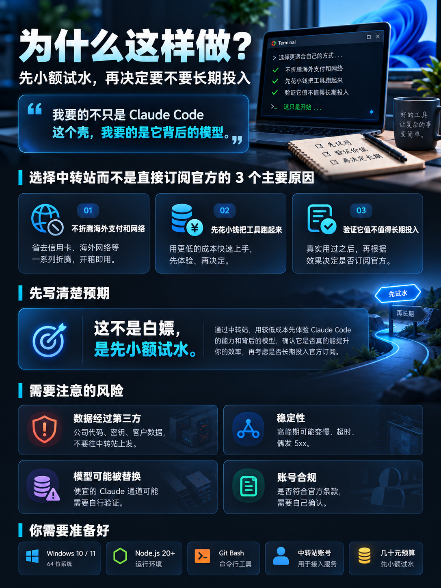
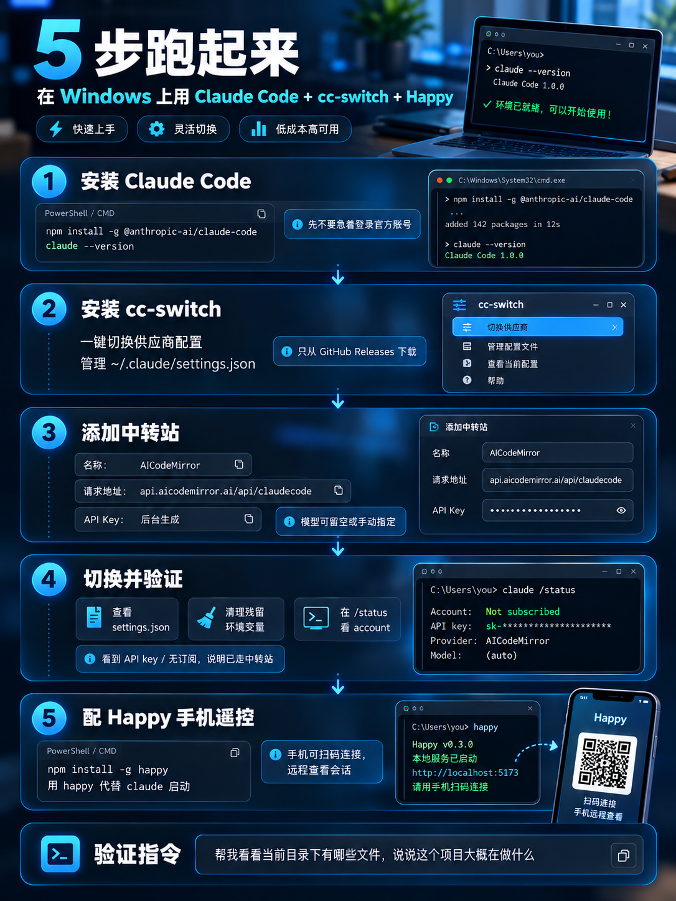

## 我为什么要做这件事

想正经用上 Claude Code 这个念头，在我脑子里转了大概两个月。

网页版我一直在用，写代码、问问题、改文案都挺顺手。但网页版和 Claude Code 是两个东西 —— 网页版是「我问你答」，Claude Code 是「我指个方向，你自己去改我的项目」。

其实我不是没碰过 Claude Code CLI。之前在 Windows 上用它接 GLM 编程套餐的模型（GLM-5.1）做项目，完全没感受到它厉害在哪。后来才想通问题出在哪：**Claude Code 的价值一半在 harness** —— 它怎么规划任务、怎么读文件、怎么调工具、出错之后怎么自己回滚重来；**另一半，也是对产出质量影响更大的一半，在背后的模型。** 同一个 prompt，换个模型，给出的方案差距是肉眼可见的。

这两年我的项目开发，基本都是拿 ChatGPT Plus 的额度在 Codex 里跑，一直嫌弃它做出来的 UI 丑。直到 opus 5.5 这批模型的作品一条条推到我面前，那种完成度让人没法再骗自己「模型都差不多」—— 我想清楚了一件事：**我要的不只是 Claude Code 这个壳，我要的是它背后的模型。**

那我为什么不直接订阅官方？卡住我的不是订阅费本身，是那一整套「身份工程」：网上防封指南满天飞，照着做还是有人被封；支付方式、IP 出口、系统语言、时区得连成一条一致的线，想要干净的独占 IP，还得长期租 VPS。这套隐形成本算下来，比 $20/月 高多了。

所以我选了一条折中路：**用第三方中转站，先充一笔小钱，把工具跑起来，验证它值不值得长期投入。**



## 动手之前

先把预期写在这儿，省得你照着做完发现不是你想的那样。

**这不是「白嫖」，是「先小额试水」。** 中转站的成本优势来自批量采购和区域差价，不是因为它免费。你要花钱，只是花得少一点、灵活一点。

**风险要提前知道：**

| 风险 | 具体是什么 |
| --- | --- |
| 数据经过第三方 | 你的代码和 prompt 会经过中转站的服务器，不再只属于你和 Anthropic。**公司代码、密钥、客户数据，别往中转站上发** |
| 稳定性 | 高峰期可能变慢、超时、偶发 5xx。它不是官方 SLA |
| 模型可能被替换 | 便宜的「Claude 通道」有可能是别的模型在冒充。要验证 |
| 账号合规 | 官方服务条款对这类转发路径的态度，你需要自己确认 |

**你需要准备好：**

- Windows 10 或 11（我在 Windows 11 Pro 上做的）
- Node.js —— 建议 20 以上，我的环境是 Node 24.14
- Git —— 装 Git Bash，Claude Code 在 Windows 上很多操作依赖它
- 一个中转站账号，以及一笔预算。**建议第一笔控制在几十块钱以内**，跑通了再追加
- 时间：顺利的话 40 分钟，踩坑的话一个下午。如果你本来就是开发者，上面这些环境多半是现成的，真正要做的只是注册中转站、充一小笔钱

## 具体怎么做



### 第一步：装 Claude Code

官方安装脚本有好几种，Windows 上最省事的是 npm：

```bash
npm install -g @anthropic-ai/claude-code
claude --version
```

装完先**不要**急着登录。因为下一步我们要把它的认证方式改掉，你现在登录官方账号，后面还得登出。

如果 Windows 弹 SmartScreen 或者权限警告，用管理员身份开终端重跑一次。

### 第二步：装 cc-switch

这一步是整件事的关键。[cc-switch](https://github.com/farion1231/cc-switch) 是一个开源的桌面应用，专门干一件事：**管理并一键切换 Claude Code 的供应商配置。**

它解决的痛点很具体。Claude Code 换供应商，本质上是改 `~/.claude/settings.json` 里的三个字段：

```json
{
  "env": {
    "ANTHROPIC_BASE_URL": "https://你的中转站地址",
    "ANTHROPIC_AUTH_TOKEN": "sk-你的key",
    "ANTHROPIC_MODEL": "claude-opus-5-5"
  }
}
```

手动改当然可以。但如果你要在「官方 / 中转站 A / 中转站 B / 国产模型」之间来回切，每次手改 JSON 就是在赌自己不手抖 —— 少一个逗号，Claude Code 直接连不上，而且报错信息不会告诉你哪错了。

cc-switch 把这件事变成了点一个按钮。它还顺手做了备份、配置导入导出、端点测速。

**⚠️ 先记这一条：cc-switch 是完全免费开源的，只从 GitHub Releases 下载。**

### 第三步：添加中转站作为供应商

在 cc-switch 里点右上角的 `+` 添加供应商。我目前用的是 AICodeMirror，要填三样东西：

| 字段 | 填什么 |
| --- | --- |
| 名称 | AICodeMirror |
| 请求地址 | https://api.aicodemirror.ai/api/claudecode |
| API Key | 中转站后台生成的 key |

模型那一栏可以留空走默认，也可以指定。

要注册的话，这是我的邀请码：https://www.aicodemirror.ai/register?invitecode=O1T37M

### 第四步：切换并验证

回到供应商列表，选中刚加的，点启用。cc-switch 会把配置写进 `~/.claude/settings.json`。

**然后关掉当前终端，重新开一个**，运行：

```bash
claude
```

#### 先看一眼配置有没有落盘

这一步比在 Claude Code 里找状态显示更直接：

```bash
cat ~/.claude/settings.json
```

你应该能在 `env` 段里看到 `ANTHROPIC_BASE_URL` 和 `ANTHROPIC_AUTH_TOKEN` 两个字段。**没看到就说明 cc-switch 没写成功**，别往下走，先解决这一步。

#### 再确认 shell 里没有残留

配置文件不是最高优先级的。如果你之前手动 `export` 过同名变量，它会盖掉配置文件：

```bash
echo $ANTHROPIC_BASE_URL
echo $ANTHROPIC_AUTH_TOKEN
```

只要有一个有输出，就说明有残留，用 PowerShell 删除用户级环境变量：

```powershell
[Environment]::SetEnvironmentVariable("ANTHROPIC_BASE_URL", $null, "User")
[Environment]::SetEnvironmentVariable("ANTHROPIC_AUTH_TOKEN", $null, "User")
```

#### 然后用 /status 看账号

```
/status
```

⚠️ **这里有个很多人（包括我）会踩的预期偏差**：`/status` 打开的是设置界面的 Status 标签，它显示的是**版本、模型、账号、连通性** —— 它**不显示 Base URL**。所以别去找那一行，找不到的。

要看的是 **account（账号）那一行**：

- 显示你的订阅（Pro / Max）→ **说明没切过去**，请求还在走官方
- 显示用的是 API key / 没有订阅 → 说明已经走你自己的 key 了，也就是中转站在生效

#### 最后做功能验证

配置层面看完了，还得确认它真能干活：

```
帮我看看当前目录下有哪些文件，说说这个项目大概在做什么
```

能正常列出文件并给出合理总结，就成了。

### 第五步：配 Happy，用手机遥控

这一步不是必须的，但它解决了一个很实际的问题：**Claude Code 跑长任务的时候，你得盯着屏幕。**

[Happy](https://happy.engineering) 是一个开源（MIT）的客户端，有手机 App 也有 Web 端。装完之后，你在电脑上跑会话，手机上能实时看到它在干什么；它需要你确认权限的时候，手机会推通知；你人不在电脑前，也能一句话让它继续。

它不只支持 Claude Code，Codex 也能接 —— 官网标题写的是 Claude Code、Codex 和 Grok 三家。

它的架构很简单，三部分：电脑上跑的 CLI 负责启动和监听 Claude Code，把内容加密后发到中继服务器；手机或浏览器上收下来解密显示；中继服务器只是个搬箱子的，看不到内容。

安装：

```bash
npm install -g happy
```

> 老教程里写的 `happy-coder` 是项目早期的包名，现在停更在 1.1.x。**认准 `happy` 这个包名**，它的 bin 还是叫 `happy`，所以有人两个都装了也不冲突，只是版本会旧。

然后**用 `happy` 代替 `claude` 启动**：

```bash
happy
```

启动之后终端里会出来一个二维码，用手机上的 Happy App 扫一下就连上了（App Store 搜 happy）。

## 我踩到的坑

### 中转站临时抽风：503 No available channel

写这篇的时候我正在跑一个后台任务，中途拿到这么一条报错：

```
API Error: 503 No available channel for model xxx under group xxx (distributor)
```

翻译过来就是：**这个模型分组下面，当前没有可用的通道。**

这不是配错了，是中转站侧的容量问题 —— 某个模型组在高峰期被占满了。它通常会自己恢复，重试几次就好。

但它说明一件事：**你的开发流程依赖的是第三方的容量，而不是官方容量。** 这就是前面那张风险表里「稳定性」一行的实证。真到赶进度的时候，你得知道临时切回官方订阅、或者换个模型分组，是备选方案。

## 结果与花费


先交代数字：

- 充值 100 元，首充 8 折，实付 80
- 然后我跑了一个项目的重构
- 跑完一看：100 元额度烧完了，余额还是负的 —— 倒欠平台 100 元

算下来，这一次重构烧掉了 200 元上下的 token。

看到那个负数的时候，我第一反应不是心疼，是懵：**是我的用法不对，还是这玩意儿根本不省钱？**

冷静下来拆了拆，问题主要出在我自己身上：我把整个重构原封不动丢给了 opus 5.5，放任它以 agent 模式一路狂奔 —— 自己读文件、自己改、自己跑测试，一个会话几百次工具调用。最贵的模型配最费 token 的跑法，烧钱是必然的，跟走不走中转站关系不大。

所以这段「翻车」我原样写进来，它比「我省了多少钱」更有用。我现在给自己立了几条规矩：

- **opus 5.5 留给关键决策**：定方案、评审架构、啃疑难 bug
- **大改动先要计划再放行**：让它先列改动清单，我确认了再执行，别放任一路狂奔
- **日常小活用便宜模型**：改文案、查配置、写小脚本，便宜模型干这些完全不虚
- **盯余额**：中转站后台有消耗明细，每天看一眼，超支当场就能发现

80 块钱买来这套认知，我觉得值。但如果你和我一样是「先试水」的心态，把这条经验直接拿走：**按量付费的成本弹性是双向的 —— 省得了小钱，也烧得掉大钱。**

## 小结

三条我现在的判断：

1. **cc-switch 值得装**，但它值得装的理由不是「能省订阅费」，是「能在多个供应商之间无痛切换」。如果你只用一个供应商，直接改 `settings.json` 更快，别为了省事装个桌面应用
2. **中转站适合验证，不适合长期承载。** 拿它试水、跑非敏感项目没问题；一旦你确认了自己的使用习惯，值得重新算一遍官方订阅的账
3. **先用起来，比配置得完美更重要。** 我在配置上纠结的时间，如果拿来实际用，早就把这点钱挣回来了

---

## 参考链接

- Claude Code 官方文档：<https://docs.claude.com/en/docs/claude-code>
- cc-switch 项目地址：<https://github.com/farion1231/cc-switch>
- Happy 官网：<https://happy.engineering>
- Happy 源码：<https://github.com/slopus/happy>
