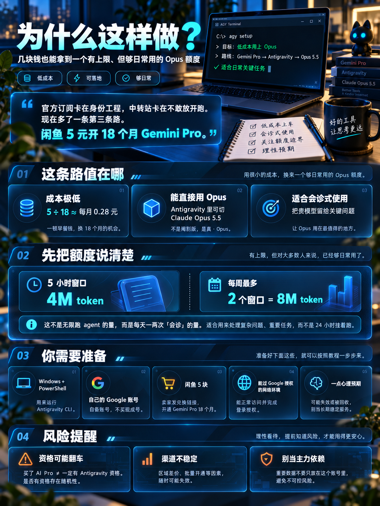
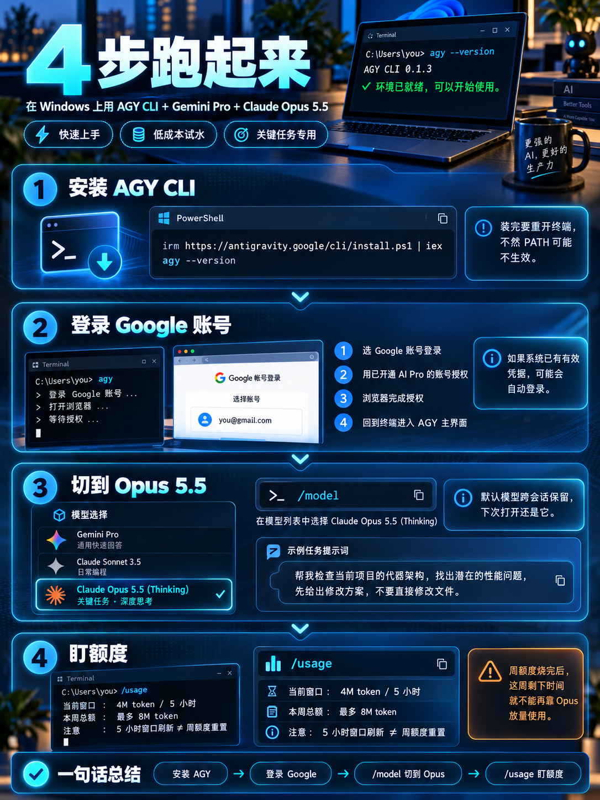
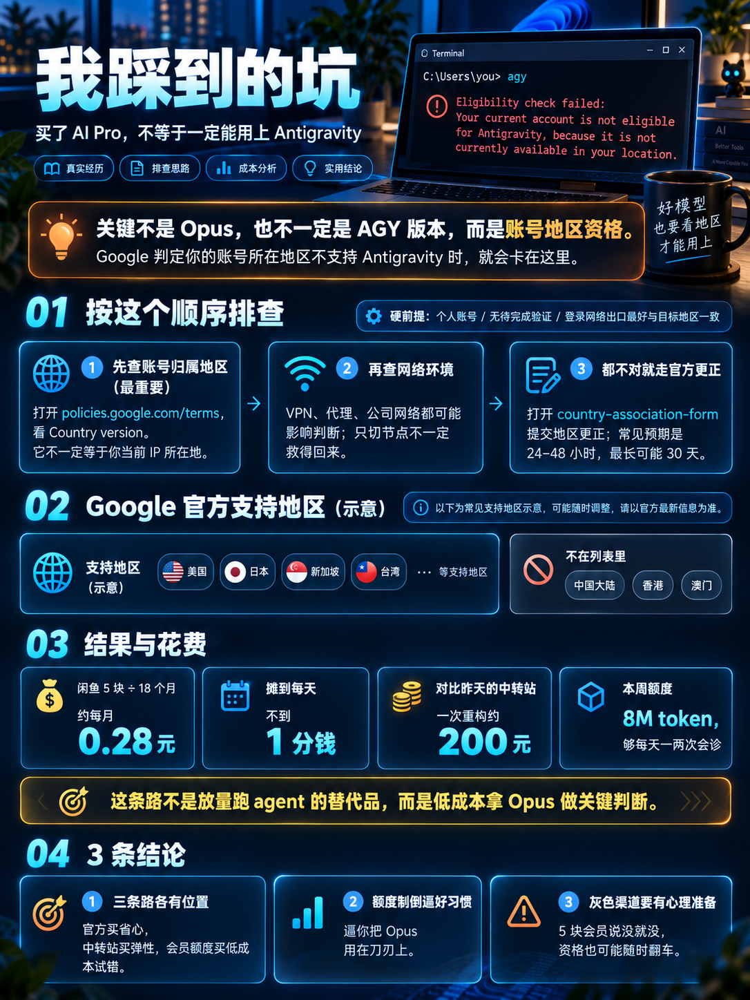

## 我为什么要做这件事

昨天那篇写到：我在中转站充了 100 块，一晚上跑完一个项目重构，余额变成负 100。按量付费这条路能跑通，但它有个先天问题 —— **成本跟用量线性挂钩，跑得越多烧得越多。**

官方订阅 $20/月，卡在那套「身份工程」上，或许后来我还是会选择它；中转站按量付费，卡在不敢放开跑。那有没有第三条路：花几块钱，拿到一个**有上限、但够日常用**的 opus 额度？

还真有，而且「几块钱」是字面意思 —— 答案也不是我刻意找到的，是推送喂到嘴边的。

最近刷到的地方全是同一个话题：Antigravity 里能用上 opus，闲鱼上几块钱就能开 18 个月的 Gemini Pro。这种全网同款的推送，我平时是当噪声划走的，但这次划不动 —— 我手上正好有非用 opus 不可的活，试错才几块钱。那就试试。

Google 的 Antigravity（Google 自己的 agentic 编程工具）里，模型选择器不只是 Gemini 家 —— 它接入了 Anthropic 的 Claude，最近加上了 opus 5.5 和 Sonnet 5.5。而 Antigravity 的使用资格，跟着 Gemini Pro（Google AI Pro）会员走。

更妙的是 Gemini Pro 的价格：闲鱼上 5 块钱，18 个月。

5 ÷ 18，每个月两毛八。这就是标题里那「5 块钱」。



## 动手之前

先把额度说清楚，省得你抱着「无限 opus」的预期来：

- 5 小时窗口 4M token
- 一周最多 2 个 5 小时窗口，也就是一周 8M token

这不是放任 agent 狂奔的量，是**每天一两次「会诊」**的量 —— 正好逼你用昨天说的那套「opus 只干关键活」的用法。

你需要准备：

- Windows + PowerShell（我在 Windows 11 上做的）
- 一个自己的 Google 账号。注意是**自备账号**，不是买一个现成的
- 闲鱼 5 块钱：搜 Gemini Pro 相关的优惠，卖家发你一个兑换链接，粘贴到浏览器打开，点蓝色按钮激活就行
- 网络环境能过 Google 授权 —— 这一步后面有个大坑，先记着

风险也照实说：这个价格能存在，靠的是区域差价和批量开通，不是 Google 发善心。它随时可能失效或被回收，别把重要数据只放在这个账号上。

## 具体怎么做



### 装 AGY CLI

Antigravity 有桌面版，也有 CLI，命令叫 `agy`。PowerShell 里一条命令：

```powershell
irm https://antigravity.google/cli/install.ps1 | iex
agy --version
```

装完**重开一个终端**再验证，不重开的话 PATH 不生效。

### 登录 Google 账号

终端输入 `agy`，首次运行会进初始化界面，然后弹浏览器做 Google 授权：

1. 选 Google 账号登录
2. 用已开通 AI Pro 的那个账号
3. 浏览器里完成授权
4. 回到终端，进入 AGY 主界面

如果系统之前保存过有效凭据，它会直接自动登录，跳过授权。

### 切到 Opus 5.5

进交互界面后输入 `/model`，在模型菜单里找到 `Claude Opus 5.5 (Thinking)`，选中即可。默认模型**跨会话保留**，下次打开还是它。

然后就能正常派活了，比如：

> 帮我检查当前项目的代码架构，找出潜在的性能问题，先给出修改方案，不要直接修改文件。

### 盯额度

交互界面里输入 `/usage`，能看到模型用量和剩余额度。

一个容易搞混的点：**5 小时窗口刷新了，不等于周额度也重置了。** 周额度是独立计数，周四就把 8M 烧完的话，这周剩下的日子 opus 就跟你没关系了。

## 我踩到的坑



装完第一次登录，等来的不是主界面，是这个：

```
Eligibility check failed:
Your current account is not eligible for Antigravity,
because it is not currently available in your location.
```

第一反应是懵的：我钱都花了（才 5 块），你跟我说没资格？

查清楚后，这个报错的含义是：**AGY 在做账号资格检查，Google 判定你的账号所在地区不支持 Antigravity。** 它不是 opus 的报错，也不一定是 AGY 版本问题。关键在这一句：**买了 AI Pro ≠ 有 Antigravity 资格**，资格跟着账号地区走。

Antigravity 的官方支持地区包括美国、日本、新加坡、台湾等；中国大陆、香港、澳门不在列表里。

按这个顺序排查：

1. **先查账号归属地区（最重要）。** 登录状态下打开 <https://policies.google.com/terms> ，页面上的 Country version 一行就是账号关联的地区。**它不一定等于你当前 IP 所在地** —— VPN 挂在美国、账号归属在别处，照样报这个错。顺带说一句：Google Play 商店设置里也有个「国家/地区」，那是另一套体系，改它对 Antigravity 资格没用
2. **再查网络环境。** VPN、代理、公司网络都可能让 Google 识别到不同地区。但只切 VPN 节点不一定救得回来，因为账号的地区归属是跟着账号本身走的
3. **都不对就走官方更正。** 登录后打开 <https://policies.google.com/country-association-form> ，这是 Google 官方的账号地区更正表单，选一个支持 Antigravity 的地区(比如：United States - Oregon)提交。预期先给你：官方的判定逻辑是「注册地优先，账号满一年后看你常用的访问地区」；表单提交后一般 24–48 小时生效，最长可能要 30 天。另外三条硬前提：账号得是**个人账号**（Workspace / 学校账号直接没资格）、账号没有待完成的验证、登录时的网络出口最好和账号地区一致。全都对上还报错，退出 `agy` 重新登录一次再试 —— 有人的资格状态就是登录态没刷新


## 结果与花费

账算下来是这样的：

- 闲鱼 5 块 ÷ 18 个月 ≈ 每月两毛八，摊到每天不到 1 分钱
- 对比昨天的中转站：一个重构 200 块，这条路摊一个月两毛八
- 对比官方订阅：$20/月，这条路是它的零头都不到
- 额度一周 8M token，够每天一两次正经的 opus 会诊

## 小结

1. **三条路各有位置**：官方订阅买省心，中转站按量买弹性，会员额度买「试错零成本」。我现在是 Antigravity 做日常会诊，中转站留着放量
2. **额度制倒逼好习惯**：一周 8M token，逼你把 opus 用在刀刃上 —— 和昨天立的那几条规矩是同一件事，只是这回是制度逼的
3. **灰色渠道要有心理准备**：5 块钱的会员说没就没，地区资格说翻就翻。把它当甜头，别当依赖

---

## 参考链接

- Antigravity 官网：<https://antigravity.google>
- AGY CLI 安装脚本（PowerShell 里执行）：<https://antigravity.google/cli/install.ps1>
- Google 账号地区查看：<https://policies.google.com/terms>
- Google 账号地区更正表单：<https://policies.google.com/country-association-form>

