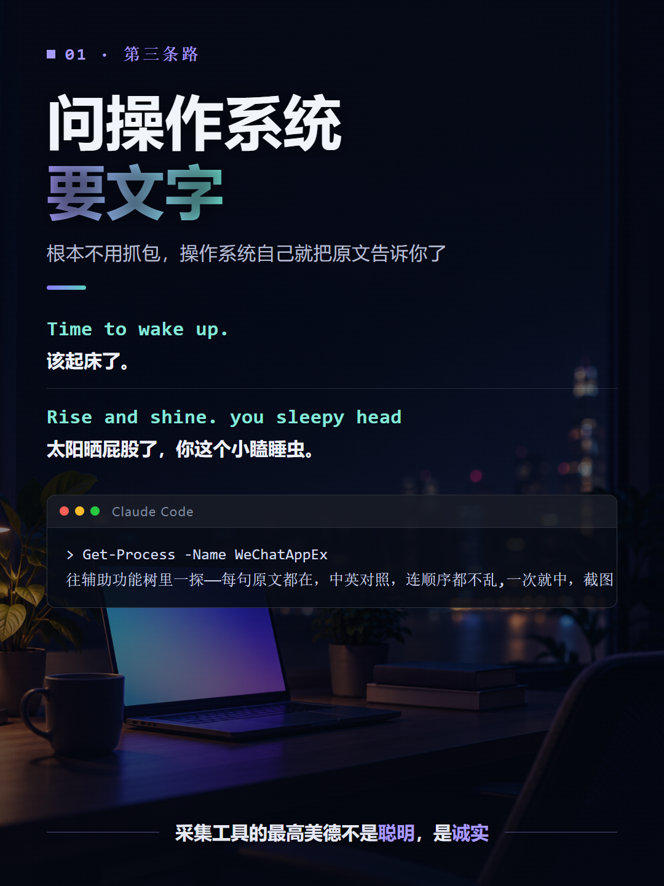
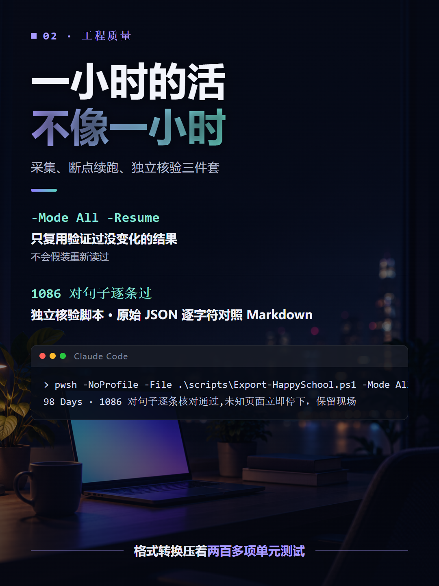

昨天发了《亲子英语打卡 01》，有读者问那些句子哪来的。来源是一个叫「快乐掌上学」的微信小程序，里面有个「亲子口语跟读」栏目：家庭天地、校园时光、游戏互动……每个课程按「Day1 起床」「Day2 睡觉」排，每天十来句中英对照。

内容是好内容，问题是用法太原始：小程序里不能复制，我一直是拿笔一句一句手抄到笔记本上，抄完才能用。不能搜索、不能排版，更别提打印出来贴冰箱上。

所以今天我干了件事：把这门课整个搬出来。战果——6 个主题、98 个 Day、1086 对中英句子，全部变成带目录的本地 Markdown。从我发出第一条消息到全量验证通过，不到一小时。

## 我先想到的是老办法：抓包

我的第一反应很「程序员」：小程序嘛，内容总得从服务器拉，抓个包，把接口返回的 JSON 拿到手，一条命令就能翻页全量拉完。以前搞别的东西这么干过，省事。

我把这想法丢给了 Codex。它没有直接开干，而是先把这条路的坑一个个摆出来：HTTPS 流量要过代理，得让客户端信任自签证书；微信这类应用可能有证书固定，装了证书也白装；就算解开了，返回的内容可能是图片、音频或者应用层加密，不是你以为的 JSON；再退一步，想脚本化重复请求，还有登录态、分页、请求签名在等着。

它最后给的结论是：这条路**不是不能走，是每一步都没有保证**，而且一旦走到「绕过」那一步，就该回头了。

我服气。这就是经验之谈——抓包这条路我以前走通过，但那是别的应用没设防。运气好和方案好，是两回事。

## AI 给的第三条路：问操作系统要文字

被劝退之后，Codex 提了一个我完全没往那边想的思路：你的小程序**在电脑微信里也能打开**，而 Windows 自带一套辅助功能框架，叫 UI Automation——读屏软件就是靠它念出屏幕上的字的。如果小程序的页面控件把文字暴露在这棵树里，那根本不用抓包，操作系统自己就把原文告诉你了。

死马当活马医。先找到窗口：

```powershell
Get-Process -Name WeChatAppEx |
    Where-Object { $_.MainWindowTitle -eq '快乐掌上学' } |
    Select-Object Id, MainWindowTitle, MainWindowHandle
```

`WeChatAppEx` 就是电脑微信里跑小程序的进程。我点开课程页面，它往辅助功能树里一探——每句原文都在，中英对照，连顺序都不乱：

```text
Page-Frame
  Text   Name="Time to wake up."
  Text   Name="该起床了。"
  Text   Name="Rise and shine. you sleepy head"
  Text   Name="太阳晒屁股了，你这个小瞌睡虫。"
```

一次就中，连备用的截图 OCR 方案都没用上。拿到的就是字符串本身，不存在认错字、配错对。

当然不是从此一帆风顺。第一个坑：微信会把**历史页面的痕迹也留在树里**，首页、课程目录、当前页混在一起，直接全量读会串页。解法是只认最后一个 Page-Frame。第二个坑：滚动列表有虚拟化，划过去的条目会被移出树，得边滚边采、保留重叠句定位。

最让我意外的是第三个坑。有个课程页里居然有空白卡片——10 个槽位只有 9 对句子。工具发现后没有「聪明地」跳过或者补一句，而是停下来，把空槽原样记录进清单，Markdown 里注明此处源页面为空。这个设计我很认同：采集工具的最高美德不是聪明，是**诚实**。



## 一小时的活，工程质量不像一小时

最后的东西不是一段一次性脚本，而是一个可以重跑的工具：采集、断点续跑、独立核验三件套。

```powershell
pwsh -NoProfile -File .\scripts\Export-HappySchool.ps1 -Mode All -Resume
```

`-Resume` 只复用验证过没变化的结果，不会假装重新读过。导完之后再跑一个**独立的**核验脚本：不走生成逻辑，直接拿原始页面 JSON 逐字符对照 Markdown，1086 对句子逐条过，目录、链接、空槽一并检查。中途遇到未知页面、缺号、配对不明，立刻停下保留现场，绝不硬着头皮往下采。

格式转换那部分还压着两百多项单元测试，连「英文撇号怎么转义才不改变显示」这种细节都有回归。



## 比这 1086 句更值钱的

活干完之后，我问了 Codex 一个问题——

> 你是怎么做到的？是你做的，而不是我做的。如果我想拥有你这个能力，需要做哪些事情？请你教我。

它给了一份完整的拆解文档：从「为什么屏幕上的文字能被程序读到」讲到窗口句柄、控件树、P/Invoke，每一步带可以自己跑的只读命令。

这一单我最大的收获不是那 1086 句，是两句话。

第一句：让 AI 替你干活，你得到一次结果；让 AI 把能力拆给你看，你得到一条路径。前者它永远比你快，后者你才真的拥有。

第二句：我提的第一条路是死胡同，它提的第二条路我压根没听说过。AI 时代真正的杠杆，是把自己的搜索空间撑大——你的认知边界外，从此多了一个不会累的探路人。

至于那 1086 对句子——后面亲子英语打卡的素材库就有了。以前手抄一课的功夫，现在够我把整个课程打印装订。


## 参考链接

- Windows UI Automation 概览：<https://learn.microsoft.com/en-us/dotnet/framework/ui-automation/ui-automation-overview>
