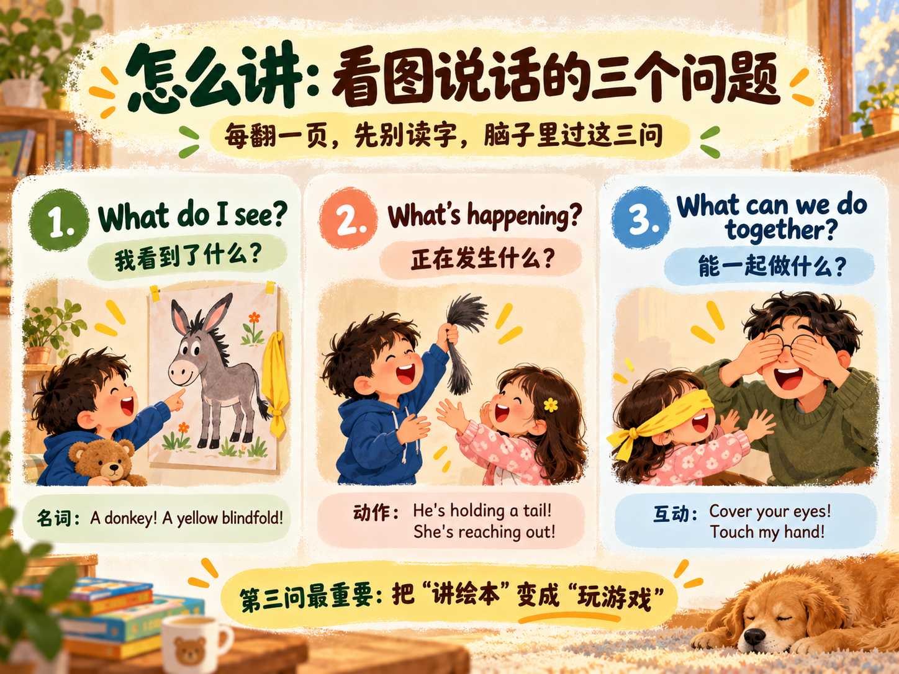
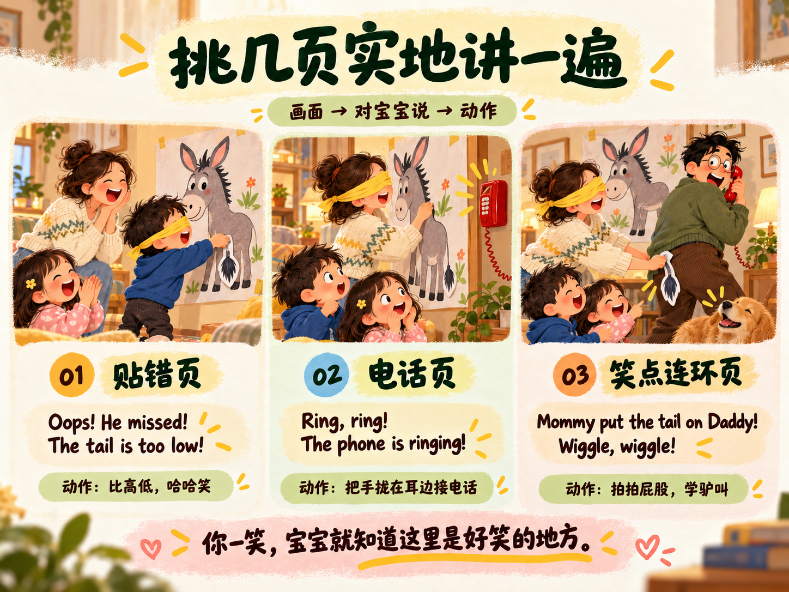
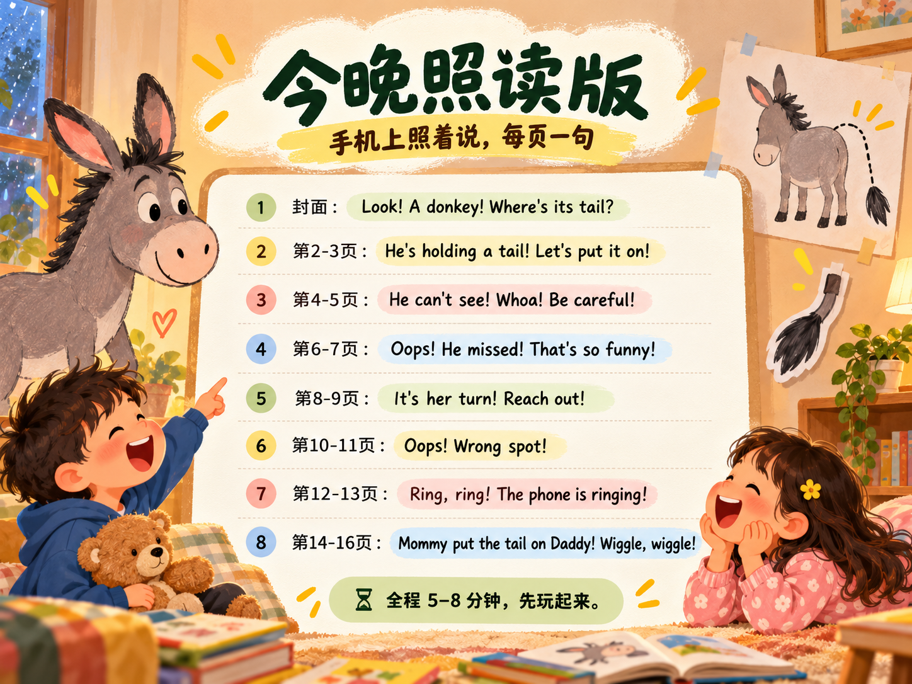

## 一本让我傻眼的绘本

红火箭分级读物里的一本《Donkey's Tail》，全文就一个句型来回换词：

```
Look at the tail.
Look at the blindfold.
Look at the boy.
Look at the girl.
Look at the tail.
Look at the phone.
Look at the donkey.
Look at Dad!
```

八句话，其实是一句话。念完只要三十秒，翻篇等于什么都没发生。我当时的原话是：怎么把画面里的内容更丰富地讲给她听？

我把整本书一页一页拍给 ChatGPT，让它帮我拆画面、给讲法，来回磨了两轮——我挑了好用的留下来，今晚就照这个讲。

先把这本书的故事讲清楚，再说怎么讲。

## 这本书到底讲了什么

外面下雨，爸爸想出一个室内游戏：pin the tail on the donkey。这是美国家庭派对的经典节目——蒙上眼睛，原地转几圈，把一条纸尾巴贴到驴子海报上该贴的位置。这本书就是把这个游戏一页一页画了出来。

然后轮流上场，轮流翻车：

- 哥哥蒙上眼，尾巴贴得太低；
- 姐姐伸着手一通摸，抓到了驴脑袋；
- 轮椅上的小朋友和粉衣服的小妹妹，也没贴对。

轮到妈妈时好戏来了：墙上红色的电话突然大响。妈妈蒙着眼被吓一跳，转错了方向，一路摸到正在接电话的爸爸身后——把尾巴端端正正贴在了爸爸的裤子上。

最后一页，Look at Dad! 爸爸长出了一条驴尾巴。

笑点靠前面七八页「人人贴错」铺垫，一页都不能跳。

## 怎么讲：看图说话的三个问题

每翻一页，先别读字，在脑子里过三个问题：

1. **What do I see?** —— 我看到了什么？A donkey! A yellow blindfold!
2. **What's happening?** —— 正在发生什么？He's holding a tail! She's reaching out!
3. **What can we do together?** —— 能带着宝宝一起做什么？Cover your eyes! Touch my hand!

第一问练名词，第二问自然带出现在进行时，第三问直接变成动作。这三个问题过一遍，每页就有三四句英语，不用背。

拿蒙眼页（第4-5页）举例：爸爸把黄布条系在男孩眼睛上。

- What do I see? → **Look! A yellow blindfold!**
- What's happening? → **He can't see!**
- What can we do together? → 我捂住自己的眼睛说 **I can't see!**，再猛地拿开手：**Peekaboo! I see you!**

第三问就是游戏本身。



## 挑几页实地讲一遍

三个最有戏的场面，每页都按「画面 → 对宝宝说 → 动作」来。

**贴错页（第 6-7 页）。** 男孩把尾巴贴在了驴腿附近，全家大笑。

> Oops! He missed! The tail is too low!
> Everyone is laughing! That's so funny!

动作：手指比高低，Up here! Not down there! 然后自己夸张地哈哈笑。你一笑，小宝宝就知道「这里是好笑的地方」。

**电话页（第 12-13 页）。** 轮到妈妈，电话突然响了。

> Ring, ring! The phone is ringing!
> What's that sound?

动作：把手拢在耳边做接电话状。What's that sound? 是这本书里最能离开绘本活下来的一句——门铃、汽车喇叭、小鸟叫，天天都能问。

**笑点连环页（第 14-16 页）。** 妈妈摸黑走偏，尾巴上了爸爸的裤子。

> Daddy is on the phone! Mommy can't see.
> Uh-oh! That's Daddy! Mommy put the tail on Daddy!
> He has a tail! Wiggle, wiggle! That's so silly!

动作：讲到最后一页，爸爸站起来拍拍自己屁股后面，Wiggle, wiggle! 再学两声驴叫，Hee-haw! Hee-haw! 这套连招必须演，不演白瞎了这本书的高潮。

原则只有一条：**英文是说给宝宝听的，中文只是自己备课用的提示，不需要每句都翻译**——动作就是翻译。



## 今晚照读版

我把备课稿删到八句，每页一句，放手机上照着说：

- 封面：**Look! A donkey! Where's its tail?**
- 第 2-3 页：**He's holding a tail! Let's put it on!**
- 第 4-5 页：**He can't see! Whoa! Be careful!**
- 第 6-7 页：**Oops! He missed! That's so funny!**
- 第 8-9 页：**It's her turn! Reach out!**
- 第 10-11 页：**Oops! Wrong spot!**
- 第 12-13 页：**Ring, ring! The phone is ringing!**
- 第 14-16 页：**Mommy put the tail on Daddy! Wiggle, wiggle!**

全程五到八分钟。宝宝要是听到第 6 页就跑去玩玩具了，随她去，这本书明天还在。



## 小结

- 分级读物的字是给宝宝认的骨架，画面才是给爸妈的讲台。一句 Look at the...，靠看图说话能扩出一场能演能玩的家庭游戏
- 每页三问：看到什么、正在发生、一起做什么。第三问最重要——它把「讲绘本」变成「玩游戏」
- 好句子要能离开绘本活下来：I can't see!、What's that sound?、It's your turn!，洗澡、穿鞋、排队全用得上

---

## 参考链接

本次备课的 ChatGPT 对话完整版（可直接打开）：

<https://chatgpt.com/share/6ad0c060-65d8-83e9-b2fc-b218d5402cf9>
