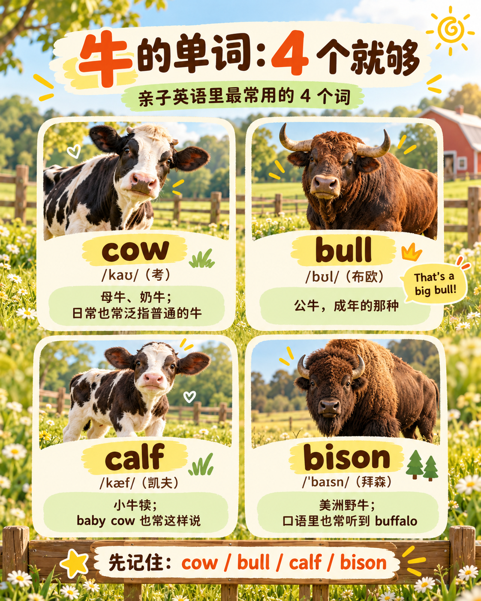
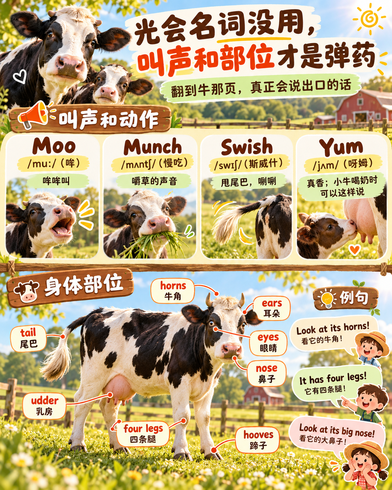
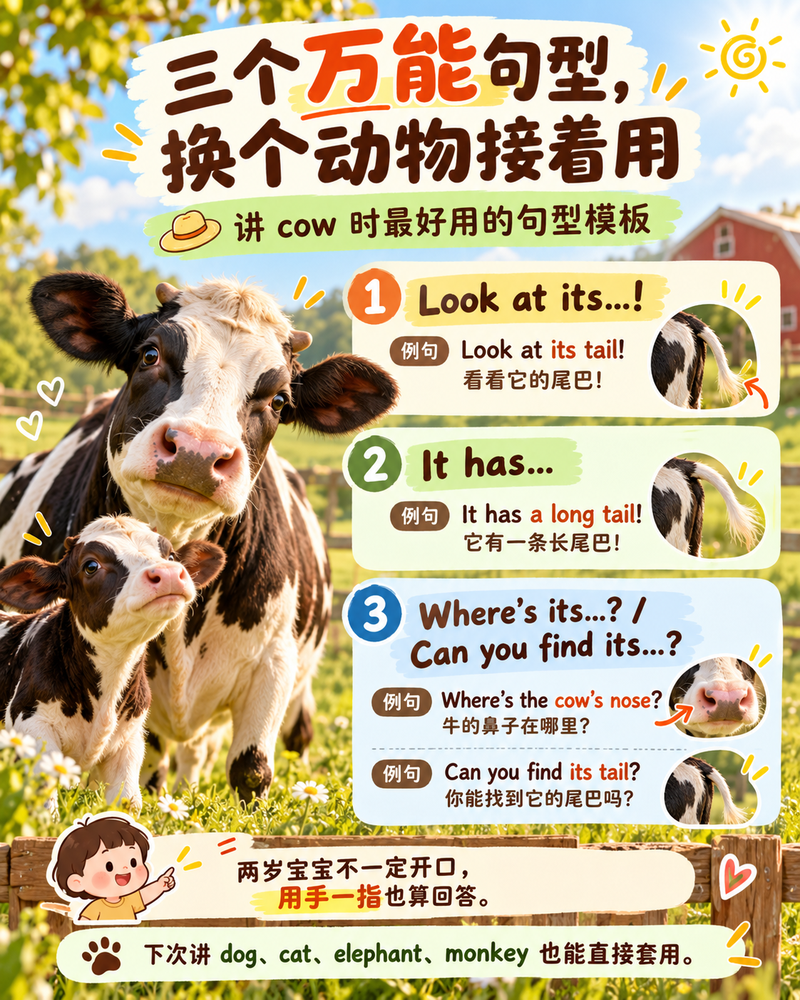
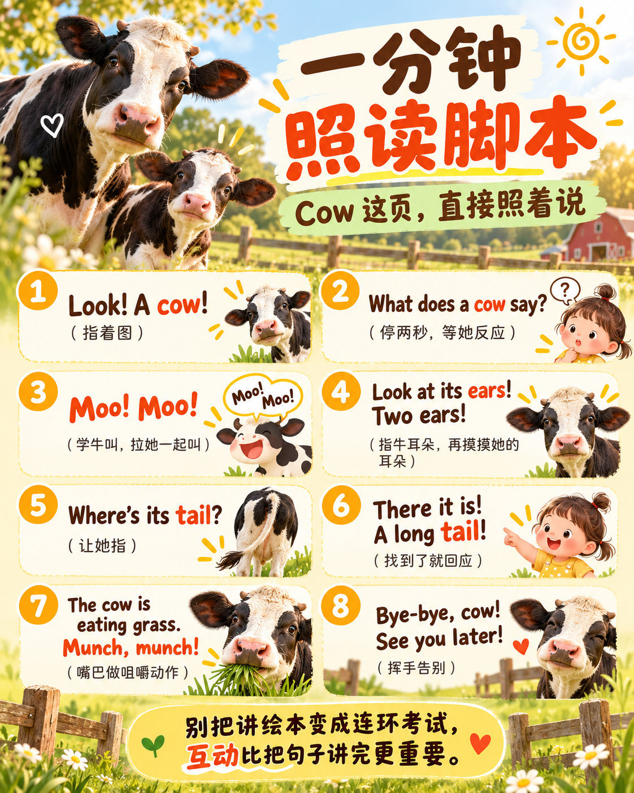

亲子英语打卡继续。这次的题目是「牛」——美国家庭里跟孩子说牛，都有哪些词？本来只想分清 cow 和 bull，结果越挖越深，从单词一路挖到照读脚本，一头牛撑起了一堂课。整理如下，当今天的打卡。

## 一、牛的单词：4 个就够



中文一个「牛」字管全部，英文是每个词管一段。cow、bull、calf 不是三种牛，是同一种牛的三种身份。每个词都配了音标和中文谐音——谐音只是近似，声调不用较真：

- **cow** /kaʊ/（谐音「考」）——母牛、奶牛，日常也泛指普通的牛，孩子最先学会的就是它
- **bull** /bʊl/（布欧）——公牛，成年的那种，That's a big bull!
- **calf** /kæf/（凯夫）——小牛犊，不分公母，复数是 calves /kɑːvz/（卡夫兹）。口语里说 baby /ˈbeɪbi/（贝比） cow 也行，更直观，两个一起教

另一批是真正的另一种动物：**bison** /ˈbaɪsn/（拜森），美洲野牛。口语里美国人也叫 buffalo /ˈbʌfəloʊ/（巴佛洛），连国家公园管理局都认这种用法，正式场合才说 bison；亚洲的水牛是 water buffalo（沃特·巴佛洛）。

至于 ox /ɑːks/（奥克斯）、steer /stɪr/（斯梯尔）、heifer /ˈhefər/（赫弗）这些役牛和牧场行话，绘本上见不到，美国家长也不会拿它们跟两岁娃说。记 4 个就够：cow、bull、calf、bison。

## 二、光会名词没用，叫声和部位才是弹药



学动物英语最容易犯的错，就是只背名称。叫声、身体部位、动作要连着一起学——这些才是翻到牛那页时真正说出口的话。

叫声和拟声词，宝宝最吃这套：

- **Moo** /muː/（哞——跟中文一个音）——哞哞叫
- **Munch** /mʌntʃ/（「慢吃」连读）——嚼草的声音
- **Swish** /swɪʃ/（斯威什）——甩尾巴，唰唰
- **Yum** /jʌm/（呀姆）——小牛喝奶，真香

身体部位，看图指哪说哪：

- **horns** /hɔːrnz/（号恩兹）牛角——Look at its horns!
- **ears** /ɪrz/（一尔兹）耳朵——It has two ears!
- **eyes** /aɪz/（爱兹）眼睛——Where are its eyes?
- **nose** /noʊz/（挪兹）鼻子——Look at its big nose!
- **tail** /teɪl/（太欧）尾巴——Its tail is so long!
- **four legs** /leɡz/（来格兹）四条腿——It has four legs!
- **hooves** /huːvz/（胡弗兹）蹄子——Look at its hooves!
- **udder** /ʌdər/（阿德儿）乳房——That's its udder.（奶牛图上才有，见到就说）

## 三、三个万能句型，换个动物接着用



- **Look at its...!** ——Look at its tail!
- **It has...** ——It has a long tail!
- **Where's its...?** / Can you find its...? ——Where's the cow's nose?

第三个句型对两岁宝宝特别友好：用手指一指就算回答，不一定非要开口说英语。

还有个美国家庭的地道习惯：把动物和宝宝自己连起来——

> The cow has two ears. You have two ears, too!
> The cow has a tail. Do you have a tail? No!

## 四、一分钟照读脚本



Cow 这页怎么讲？直接照着说，括号里的动作提示是说给自己听的：

```
Look! A cow!                           （指着图）
What does a cow say?                   （停两秒，等她反应）
Moo! Moo!                              （学牛叫，拉她一起叫）
Look at its ears! Two ears!            （指牛耳朵，再摸摸她的耳朵）
Where's its tail?                      （让她指）
There it is! A long tail!              （找到了就回应）
The cow is eating grass. Munch, munch! （嘴巴做咀嚼动作）
Bye-bye, cow! See you later!           （挥手告别）
```

补三个词的读音：**eat** /iːt/（亿特）吃、**grass** /ɡræs/（格拉斯）草、**find** /faɪnd/（范德）找。

唯一要记住的技巧：别把讲绘本变成连环考试。她指着牛角，你就顺势说 Yes! Those are its horns!；她只想学牛叫，就多陪叫几声。互动比把句子讲完重要。

## 五、今天的 5 句

- **Look at the cow!** 看这头牛！
- **What does a cow say? Moo!** 牛怎么叫？哞！
- **Where's its tail?** 它的尾巴在哪儿？
- **The cow is eating grass.** 牛在吃草。
- **Can you moo like a cow?** 你能学牛哞哞叫吗？

## 小结

- 名词只是入口，叫声、部位、动作才是亲子口语的主体，这个配比别搞反
- 三个句型是万能模具，下次讲 dog、cat、elephant、monkey 直接套
- 讲得完讲不完不重要，孩子参与过才算数
