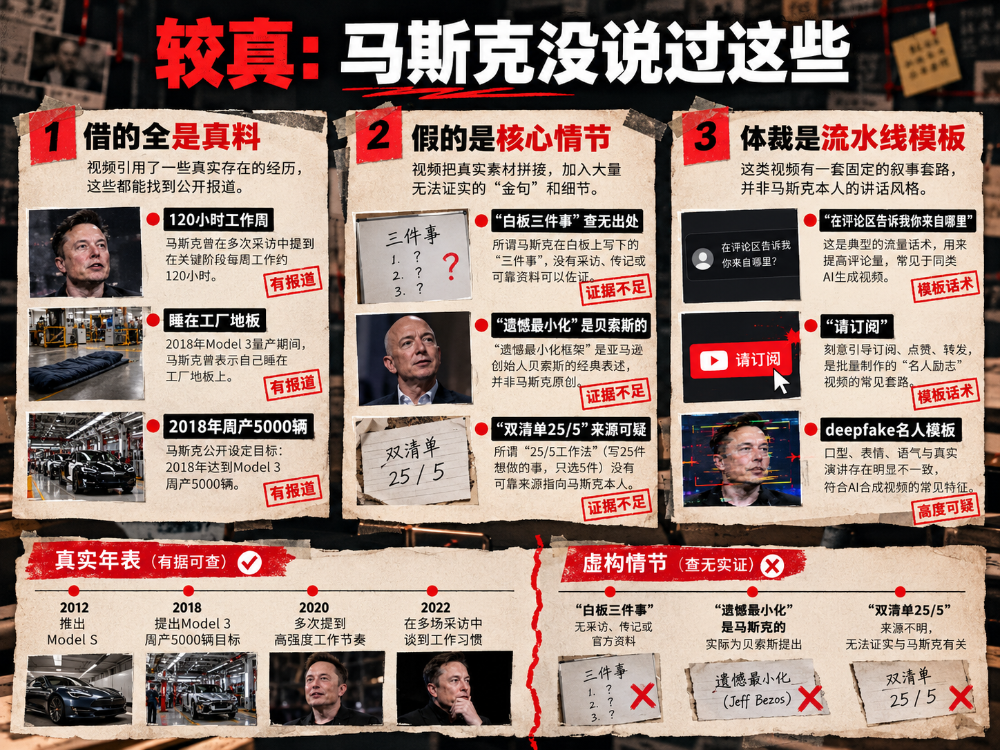

## 一条流水线，一份打印稿

昨天把一个 24 分 33 秒的「马斯克学习」视频，做成了中英双语的 A4 打印稿。活大部分不是我亲手干的——家里 Linux 服务器上长期跑着一个 hermes agent：我发视频链接，它下载；跟它要字幕，它用模型跑语音识别、翻成中文。1134 条字幕、时间轴对齐，全是它的产物；最后把字幕排版成能打印的稿子。

流水线四步：发链接 → 下载视频 → 要字幕（识别 + 翻译）→ 排版成 A4。

## 这份稿子讲了什么

剥掉名人光环，视频就三块：一个故事、一套系统、一个问题。

**一个故事**：2018 年 Tesla 卡在量产地狱，周产 5000 辆的目标只完成 2000。「我」每周工作 120 小时、睡在车间，忙到某天早上醒来，想不起前一天完成了什么——30 个会、200 封邮件，指不出一件推进目标的事。于是砍掉三天所有会议，对着白板只问一句：这周只能做三件事，做什么最接近目标？三天只干这三件——产能升 40%，两个月达标。

**一套系统**：每天早晨，看手机之前写下今天的三件事——完成了就能推进最重要目标的事，不是最紧急、最响、哄别人高兴的。配套三层分类：维护（回邮件开例会）、优化（改进流程）、变革（新东西）；多数人 80% 时间耗在维护层，视频的方子是把比例倒过来。找出来只是一半，另一半是保护：每件事配不受打扰的时间块，手机关机，提前想好干扰来了怎么办。

**一个问题**：如果每天只能工作三小时，你会做什么？按它的算法，30 岁还剩约 17000 天，扣掉睡觉通勤，真正用于有意义工作的每天只有两三小时——一年 700 到 1000 小时，这就是全部额度。「更多时间不会让你更高效，更好的选择才会。」

## 较真：马斯克没说过这些

视频并非马斯克本人演讲。发文章前我核实了一遍，证据三层。

**借的全是真料**：120 小时工作周、睡车间地板，出自 2018 年《纽约时报》和 CBS 的采访；周产 5000 辆也真是那年 7 月达成的。九真，所以听着可信。

**假的是核心情节**：「白板三件事」全网查无出处。真实的对应物是马斯克 2018 年 4 月的一封全员邮件，六条会议规则，跟「三件事」是两回事。概念也是偷的：「遗憾最小化框架」是贝索斯的招牌；巴菲特「双清单 25/5」本身就是无一手来源的传说；而马斯克真正的效率方法论「the algorithm」五步，视频只字未提。

**体裁是流水线模板**：开场「在评论区告诉我你来自哪里」、结尾「请订阅」，是 engagement bait 标准话术；假马斯克早已成产业，他是被 deepfake 最多的名人。

最狡猾的是把虚构情节缝在真实年表上：白板三天是编的，「两个月达标」是真的。时间线经得起对，故事查无此说——可信度就是这么来的。

## 观点值得学吗？分三档

有意思的地方在这：骗子挑素材的标准和你我挑书一样——专挑真的抄。这套内容能流传，正因为它是百年验证的共识的 remix。按成色分拣：

**直接用**：找出少数创造不成比例价值的事，砍掉其余（帕累托原则，和 Ivy Lee 一百年前的「每天先写六件事」同源）；时间块保护深度工作（Cal Newport 整本书在论证）；多任务有害（被打断后 23 分钟才能重新专注，Gloria Mark 的研究是真的）；深度工作每天两三小时是天花板。

**打折用**：「维护压到 5%」当方向感可以，当处方不行——它自己的故事里，白板三件事干的恰恰全是维护层的活。真正的教训不是少做维护，是分清哪件维护才是瓶颈。巴菲特双清单：故事是假的，盯住机会成本这个内核是真的。

**扔掉**：三天产能 +40%、一年顶三年——编的数字；「这是马斯克在用的方法」——包装本身就是产品。

## 从明天早上开始

1. 起床上手之前，写下今天的三件事，至少一件是「变革」层——新东西，而不是回邮件
2. 给每件事配一段时间块，写进日历，手机扣过去；提前想好干扰来了怎么处理
3. 睡前打分：今天花在三件事上的时间占比多少？什么妨碍了你？
4. 做一次三小时自检：如果每天只能工作三小时，你会做什么？——答案就该出现在明天的三件事里

一张便签就够。管用的是「只选三件 + 护住它们」这个动作，坚持一个月，自然知道它对你的成色。

最后一条和效率无关：以后刷到「贝索斯/巴菲特/乔布斯说」，先搜一手来源；搜不到，就按观点本身的论证打分——观点成立与否，和谁说的零相关。

## 小结

1. 假的是马甲，不假的是问题：怎么把有限时间花在真正重要的事上。答案不新，新的是今天就开始用。
2. 逐字稿是照妖镜：1134 条字幕平铺在纸上，话术和无出处的情节全都显形。
3. 流水线既能下载假马斯克，也能拆穿假马斯克——解药和毒药，是同一个技术。

---

## 参考链接

纽约时报：Musk 谈每周 120 小时（2018-08-16）
<https://www.nytimes.com/2018/08/16/business/elon-musk-interview-tesla.html>

CBS：Musk 睡在工厂地板（2018-04-13）
<https://www.cbsnews.com/news/elon-musk-tesla-model-3-problems-interview-today-2018-04-13>

CNBC：马斯克真实的六条会议规则（2018-04-18）
<https://www.cnbc.com/2018/04/18/elon-musks-productivity-rules-according-to-tesla-email.html>

贝索斯「遗憾最小化框架」出处
<https://www.halberthargrove.com/news-guidance/news-guidance-regret-minimization-framework-jeff-bezos>

巴菲特「双清单 25/5」故事的存疑考证
<https://goalsandprogress.com/two-list-method-warren-buffetts-priority-decision-system>

假马斯克视频与诈骗（RMIT FactLab）
<https://www.rmit.edu.au/news/factlab-meta/elon-musk-used-in-fake-ai-videos-to-promote-financial-scam>

whisper.cpp（本地语音转录工具）
<https://github.com/ggml-org/whisper.cpp>
