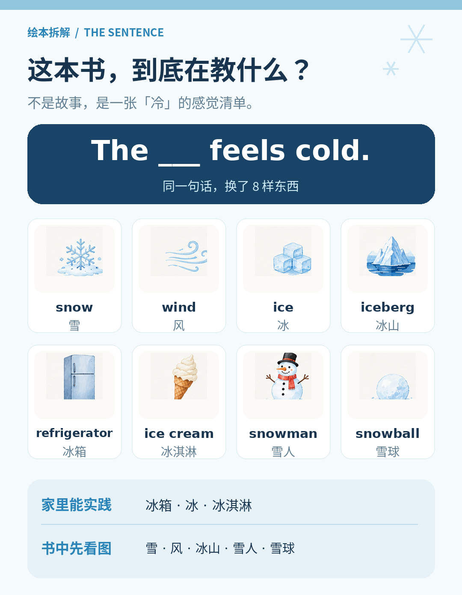
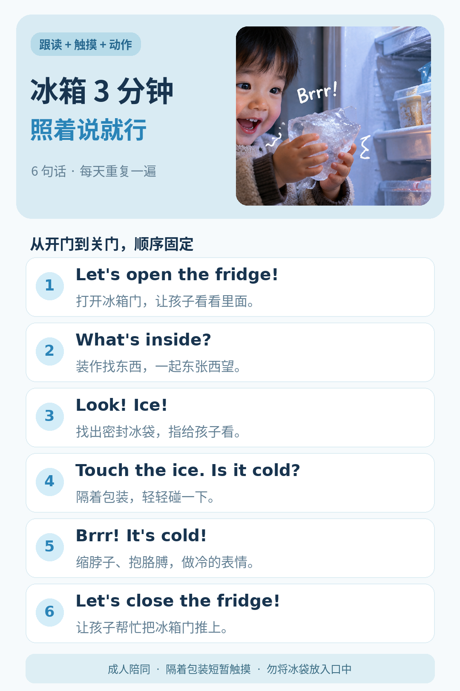
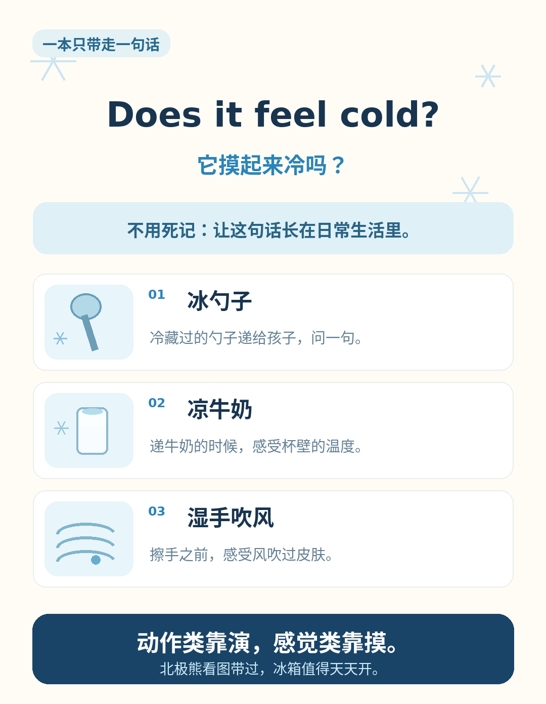

## 上一本的经验，在这一本失灵了

《Donkey's Tail》的讲法：看图说话三个问题——谁在动？在做什么？接下来呢？

《What Feels Cold？》满页都是「冷」：下雪、海风、冰山、北极熊——没有一样是我家厨房里能翻出来的东西。动作我能演，冷我演不出来。

## 这本书到底在教什么

它不是故事，没有「然后呢」——8 个跨页其实是同一个句型，换了 8 个主语：

**The ___ feels cold.**
「这个____摸起来是冷的。」

| 原文                           | 中文  | 读音                                                                     |
| ---------------------------- | --- | ---------------------------------------------------------------------- |
| The snow feels cold.         | 雪   | snow /snoʊ/ 「斯诺」                                                       |
| The wind feels cold.         | 风   | wind /wɪnd/ 「温得」                                                       |
| The ice feels cold.          | 冰   | ice /aɪs/ 「爱斯」                                                         |
| The iceberg feels cold.      | 冰山  | iceberg /ˈaɪsbɜːrɡ/ 「爱斯-波格」                                            |
| The refrigerator feels cold. | 冰箱  | refrigerator /rɪˌfrɪdʒəˈreɪtər/ 「瑞-夫瑞橘-瑞特儿」，口语直接说 fridge /frɪdʒ/ 「夫瑞橘」 |
| The ice cream feels cold.    | 冰淇淋 | ice cream /ˈaɪs kriːm/ 「爱斯-克里姆」                                        |
| The snowman feels cold.      | 雪人  | snowman /ˈsnoʊmæn/ 「斯诺-曼」                                              |
| The snowball feels cold.     | 雪球  | snowball /ˈsnoʊbɔːl/ 「斯诺-波」                                            |

句型里先记住两个词：feels /fiːlz/ 「菲欧兹」，cold /koʊld/ 「扣得」。

看清结构，这本书就好讲了：它是一张「感觉清单」，8 样东西分两类——**家里有的**：冰箱、冰、冰淇淋；**家里没有的**：雪、风、冰山、雪人、雪球。前者随手就能凑齐，这才是这本书真正的用武之地。

## 「冷」说一百遍，不如指尖碰一秒

动作类绘本靠演，这是上一本的结论。但感官类演不出来：cold 这个词，从耳朵进是翻译，从皮肤进才是理解。孩子摸到冰的那一秒，cold 和那个触感直接挂上钩，不需要任何中文解释。

所以这本书的讲法只有一条：**给不了的看图带过，给得了的当场摸。**

雪和北极熊那几页，指着图喊一句 Brrr! It's cold! 就翻过去，不用恋战；冰箱那两页，合上书，直接去厨房。

## 冰箱 3 分钟：照着做就行

六句话，顺序别乱——先开门拿东西，再让孩子摸，最后收尾关门：

1. **Let's open the fridge!** [🔊](assets/01-open-the-fridge.mp3)
   /lets ˈoʊpən ðə frɪdʒ/ 「来茨·欧盆·泽·夫瑞橘」
   拉开冰箱门，让孩子看清里面。

2. **What's inside?** [🔊](assets/02-whats-inside.mp3)
   /wʌts ˌɪnˈsaɪd/ 「沃茨·因赛德」
   装作找东西，东张西望。

3. **Look! Ice!** [🔊](assets/03-look-ice.mp3)
   /lʊk aɪs/ 「路克·爱斯」
   拿出一袋冰——冷链快递那种带塑料膜的一次性冰袋就行。

4. **Touch the ice. Is it cold?** [🔊](assets/04-touch-the-ice.mp3)
   /tʌtʃ ði aɪs. ɪz ɪt koʊld/ 「塔驰·泽-爱斯。伊兹·伊特·扣得」
   把冰递过去，让孩子拿在手里，停一秒——理解就发生在这一秒。

5. **Brrr! It's cold!** [🔊](assets/05-brrr-its-cold.mp3)
   /bɜːr! ɪts koʊld/ 「波儿——！伊茨·扣得」
   Brrr 是闭着嘴唇从喉咙里抖出来的，像发动摩托车；同时夸张地缩脖子、抱胳膊。

6. **Let's close the fridge!** [🔊](assets/06-close-the-fridge.mp3)
   /lets kloʊz ðə frɪdʒ/ 「来茨·克漏兹·泽·夫瑞橘」
   让孩子来推门——推上冰箱门，是 TA 最有成就感的部分。

两个注意：

- **带膜冰袋让孩子拿在手里摸**——隔着塑料膜不冻手，摸完放回冷冻室，明天接着用
- **3 分钟收尾，顺序固定**——天天来一遍，比一次讲透强；固定的顺序会让 TA 把这一串声音和一串动作对上号

## 一本只带走一句话

上一本只认准了 Look at the...，这一本认准：

**Does it feel cold?** [🔊](assets/07-does-it-feel-cold.mp3)
/dʌz ɪt fiːl koʊld/ 「达兹·伊特·菲欧·扣得」

比流程里那句 Is it cold? 多了一个 feel——「摸起来」，问得更完整也更地道。它的用法不在书里，在生活里：冰勺子从冷冻室拿出来、凉牛奶递过去、洗完手没擦干吹了风，都是它的出场时机。

一周下来，这句问话会自己长在生活里。书上其他扩展句，没记住就先不算数。

绘本先分型：动作的靠演，感觉的靠摸。书里给不了的别硬讲，书外给得了的别浪费——北极熊看图带过，冰箱值得天天开。

---

## 参考链接

- 红火箭 Red Rocket Reader（Fiction Level 1）：What Feels Cold?

