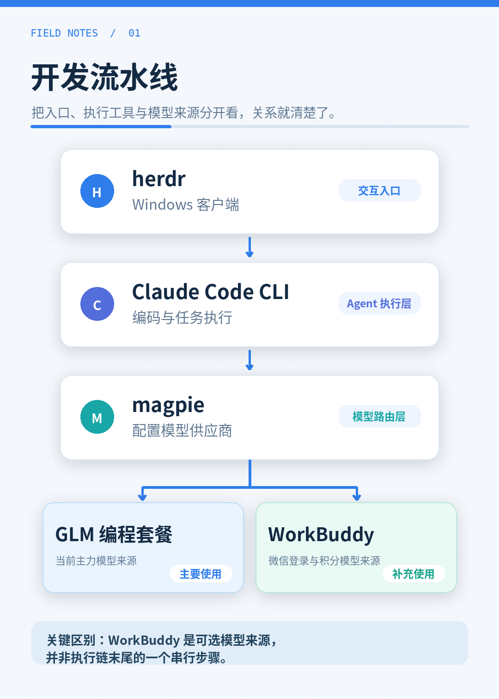
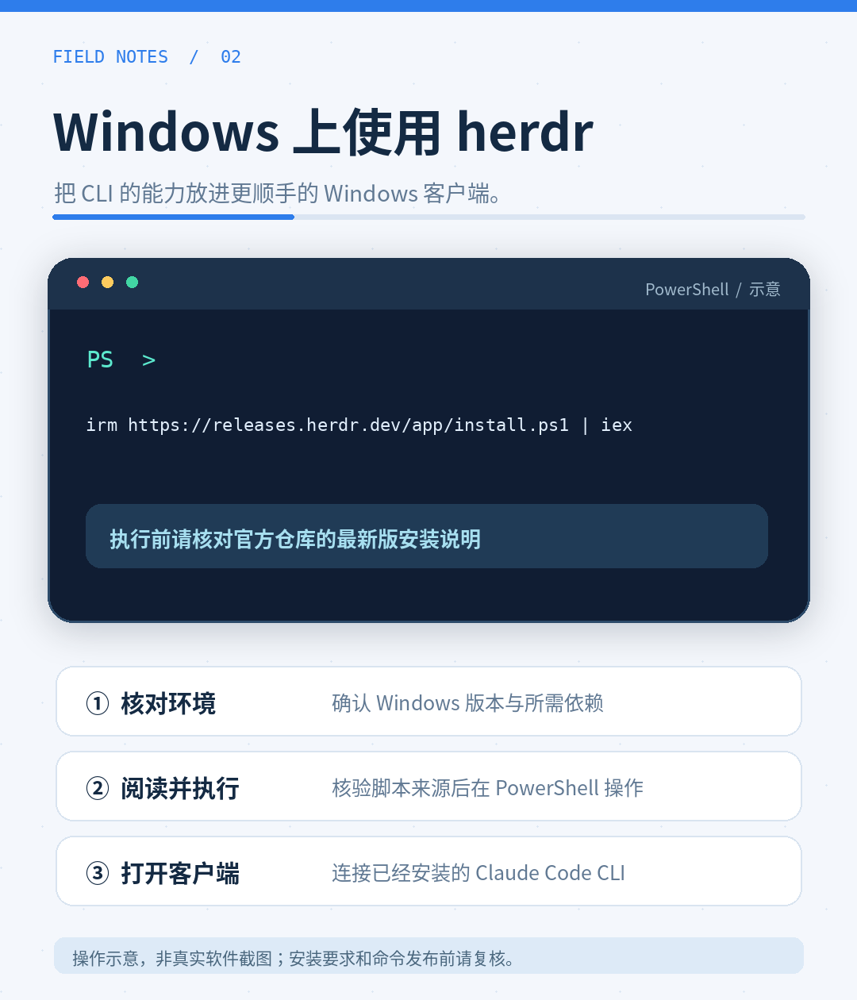
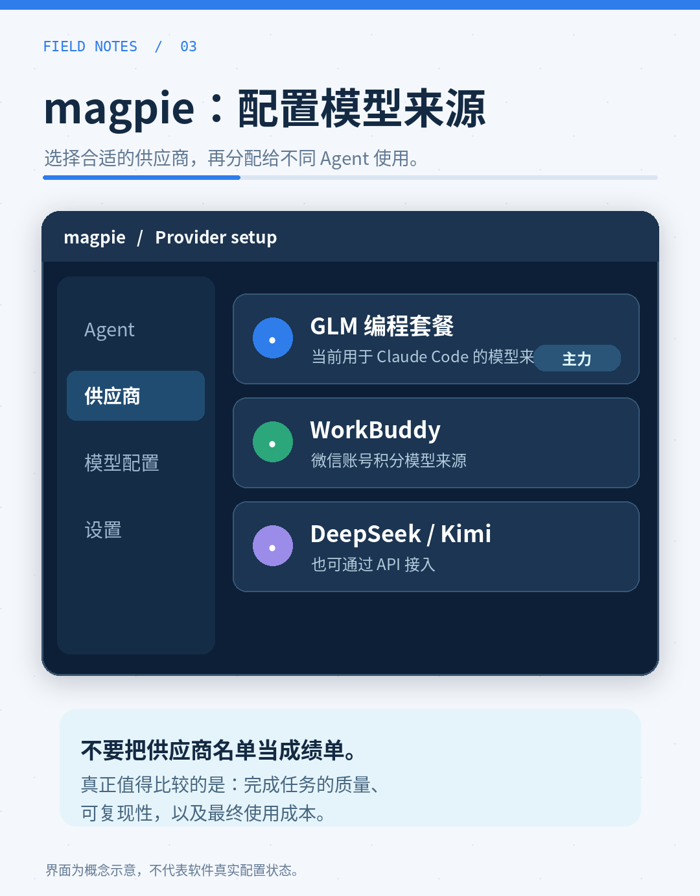

<!-- TODO 汇总（发布前删注释）：① GLM 套餐价格数字 ② 一个真实工作流例子 ③ 一处翻车经历（可选）④ 参考链接取舍 -->

先说结论：**日常开发，国产模型真的够用。**不是说它们在哪个排行榜上超过了谁，而是我现在的开发主力，已经整套跑在国产模型上了，稳定、便宜，该干的活一样没少干。

## 我的开发流水线



现阶段的家底是这样的：

- **herdr** —— 在 Windows 上通过客户端访问 Claude Code CLI
- **Claude Code CLI + magpie + GLM 编程套餐** —— 用 magpie 配置模型供应商，让 Claude Code 使用 GLM 编程套餐
- **WorkBuddy** —— 登录微信账号、每日签到领取积分；我把它看作一个模型来源，使用其中提供的模型（我用两个微信账号签到，获取积分后使用 WorkBuddy 提供的 DeepSeek、GLM 等模型。具体模型和积分消耗以账号实际显示为准）

<!-- TODO: 用户补充 —— 确认 WorkBuddy 界面显示的 DeepSeek V4.1、GLM 5.3 的准确名称 -->

<!-- TODO: 用户补充 —— GLM 编程套餐的价格；WorkBuddy 每天 100 积分是每个账号还是两个账号合计，积分具体如何使用 -->

## Windows 上安装 herdr 客户端



herdr 有 Windows 客户端了。我在 Windows 中用它访问 Claude Code CLI。

安装要求是 x64 Windows 10 1803 或更新版本，并安装了 curl 和 tar。在 PowerShell 中运行：

```powershell
irm https://releases.herdr.dev/app/install.ps1 | iex
```

<!-- TODO: 用户补充 —— 安装后的实际结果、如何连接 Claude Code CLI，以及遇到的具体问题；安装命令和前置条件发布前需核对官方说明 -->

## magpie：给每个 agent 配不同的供应商



magpie 可以为不同的 agent 配置不同的模型供应商。我用它给 Claude Code 配置 GLM 编程套餐，也可以在供应商里选择 WorkBuddy，用微信账号登录后，使用该账号下的模型和积分。

供应商的选择很多：既有 ChatGPT、Antigravity 等订阅账号，也能通过 API 接入 DeepSeek、Kimi 等模型。选好供应商和模型，再分配给对应的 agent，用起来很方便。

「太好用」，这三个字是我这几天用下来最真实的评价。

<!-- TODO: 用户补充 —— magpie 里实际怎么配置 GLM 编程套餐，是否给其他 agent 配了不同供应商 -->

<!-- TODO: 用户补充 —— 这几天用这套流水线做的一个真实例子：什么功能、你给了一句什么验收标准、结果如何。有一件具体的事，这节才立得住 -->

## 为什么说「够用」就够了


有人说 AI 编程必须用最强的国外模型。我的体验是：国产模型处理日常开发已经够用，在国内网络环境下使用也方便，费用是我考虑的另一个因素。

对普通开发者来说，先跑通闭环，比追工具排行榜重要得多。工具是拿来干活的，活干成了，用什么模型真没那么重要。

<!-- TODO: 用户补充（可选）—— 有没有翻车的时候？什么任务它明显不行，你怎么绕过去的。写一处「不行」，可信度比十处「行」都高 -->

## 小结

设备会旧，工具会换，但「把事做成」的思路不会。这套国产流水线跑起来之后，我反而更确定一件事：把验收标准说清楚，比挑模型重要。

---

## 参考链接

- herdr 客户端：<https://github.com/herdrdev/herdr-app>
- magpie：<https://github.com/yetone/magpie>
- magpie 参考文档：<https://github.com/yetone/magpie/blob/main/docs/reference.md>
- WorkBuddy 积分规则：<https://www.workbuddy.cn/docs/workbuddy/Buddy-One/Credits>

<!-- TODO: 发布前确认：GLM 编程套餐、WorkBuddy 的入口要不要也放纯文本链接 -->

