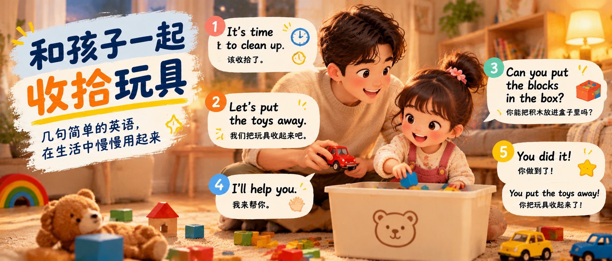

最近练习亲子英语时，我翻到了以前买的亲子口语贴。上面有几句话，是关于和孩子一起收拾玩具的。

我想知道：平时和孩子互动时，这些话用英语怎么说才自然？

比起一次记住很多句子，我更想挑几句常用的，先自己学会，再在家里慢慢用起来。

## 第一步：告诉孩子，该收拾了

玩完玩具，或者准备吃饭、出门时，可以先说：

**It’s time to clean up.**  
该收拾了。

想邀请孩子和自己一起动手，就接一句：

**Let’s put the toys away.**  
我们把玩具收起来吧。

这里 **clean up** 是收拾、整理；**put the toys away** 说得更具体，指把玩具收好、放回去。

## 第二步：指着东西，说清楚放哪里

玩具多的时候，先挑一样。比如指着积木和盒子说：

**Can you put the blocks in the box?**  
你能把积木放进盒子里吗？

说的同时示意孩子把积木放进盒子。如果孩子需要帮忙，就一起动手，并告诉孩子：

**I’ll help you.**  
我来帮你。

家里收的不是积木也没关系，先用手指着东西、带孩子做动作；熟悉之后，再把句子里的物品换成实际要收的玩具。

## 第三步：收好后，回应孩子

**You did it!**  
你做到了！

如果想说得更具体，也可以说：

**You put the toys away!**  
你把玩具收起来了！

下次玩完，不用急着把所有句子都说一遍。可以先练第一句 **It’s time to clean up**，再配合动作；等自己和孩子熟悉了，再慢慢加上其他句子。

## 发音小抄

音标供查音时参考；听发音时，可以在 Merriam-Webster 在线词典搜索单词，点击词条里的发音按钮。句子连起来怎么说，也可以在有美式语音的朗读工具中听整句。

- **clean up** /kliːn ʌp/：收拾、整理
- **put away** /pʊt əˈweɪ/：收好、放回原处
- **toys** /tɔɪz/：玩具
- **blocks** /blɑːks/：积木
- **box** /bɑːks/：盒子
- **let’s** /lets/：让我们一起

---

## 参考链接

Merriam-Webster 词典：
<https://www.merriam-webster.com/>
